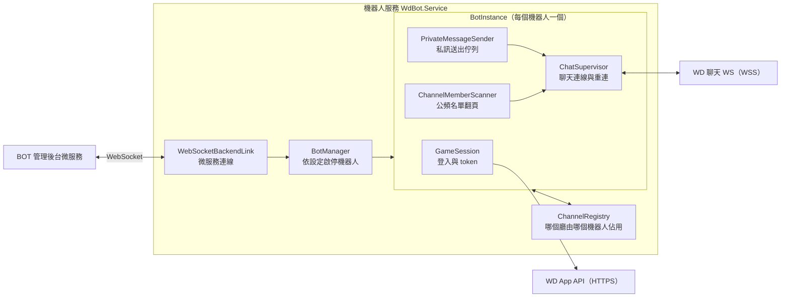
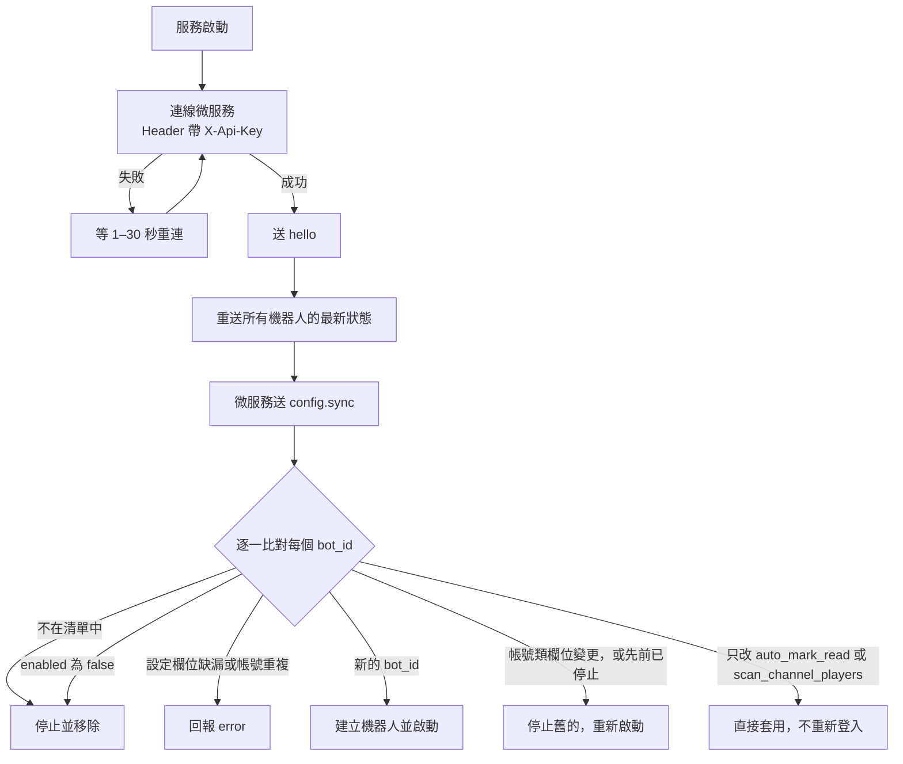
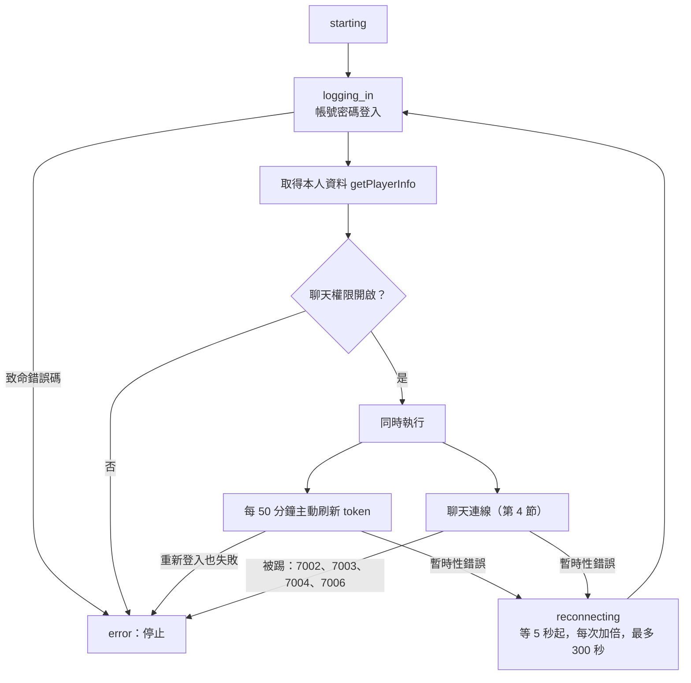
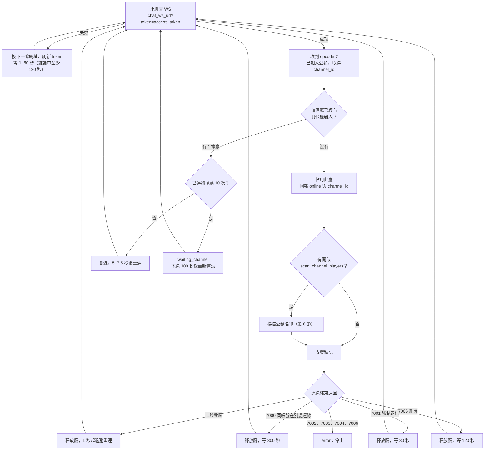
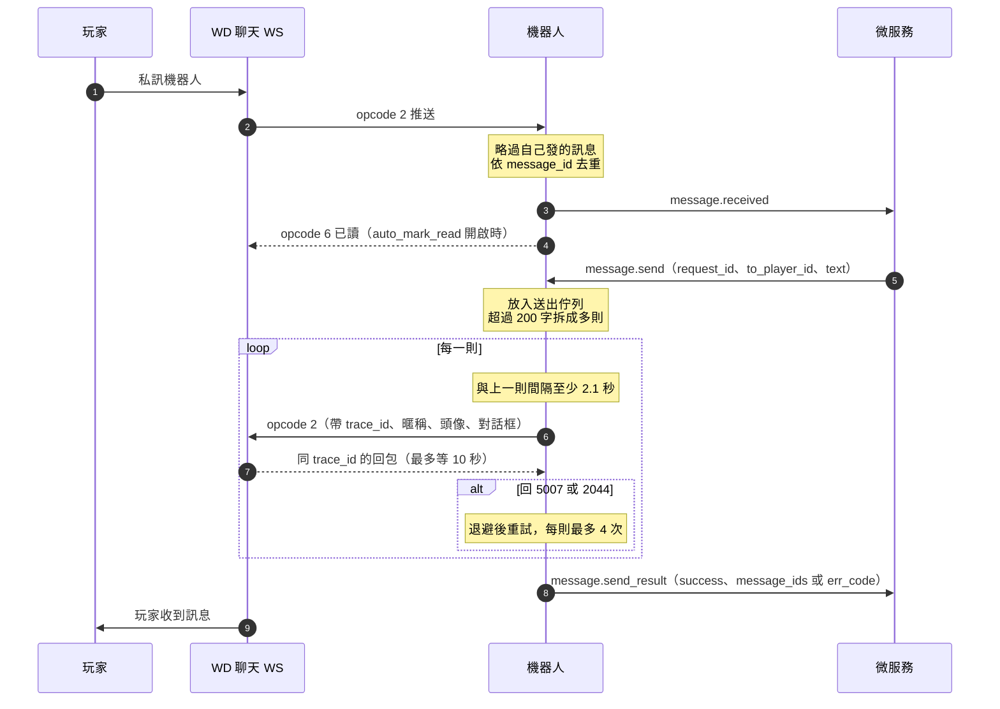
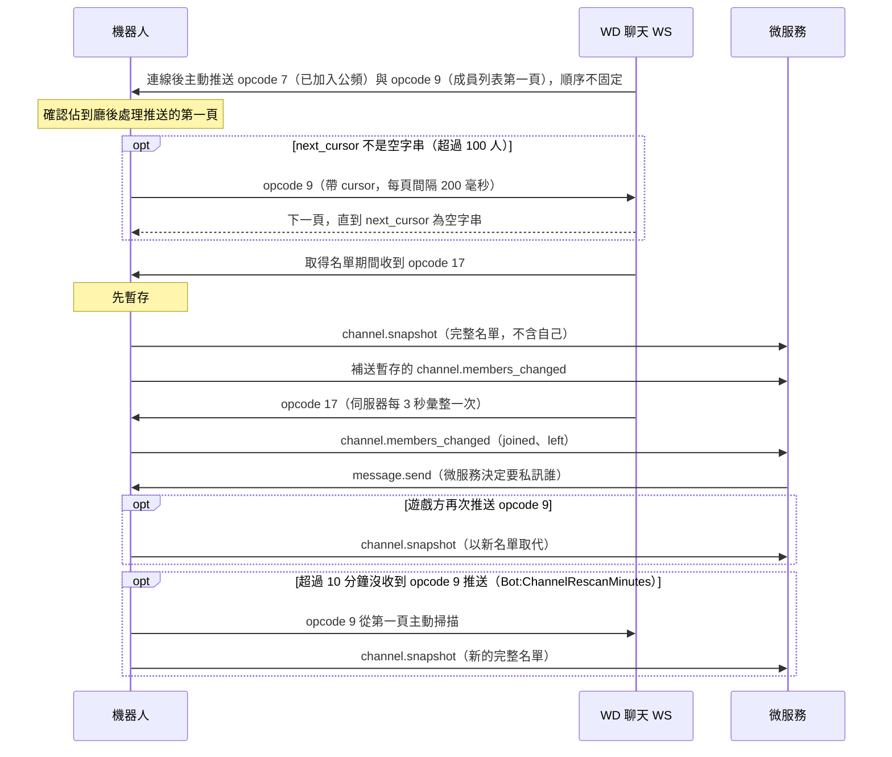
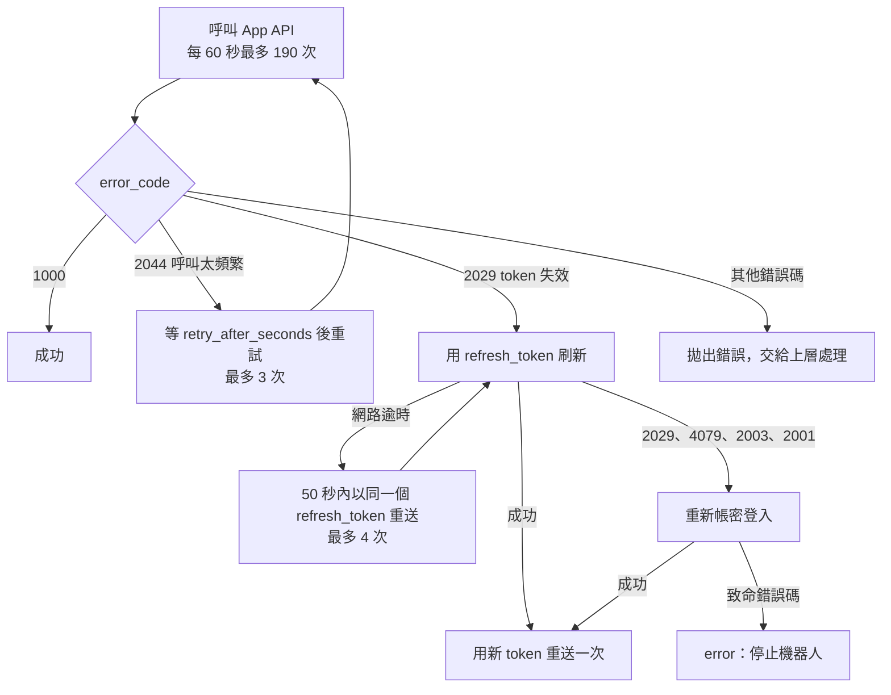
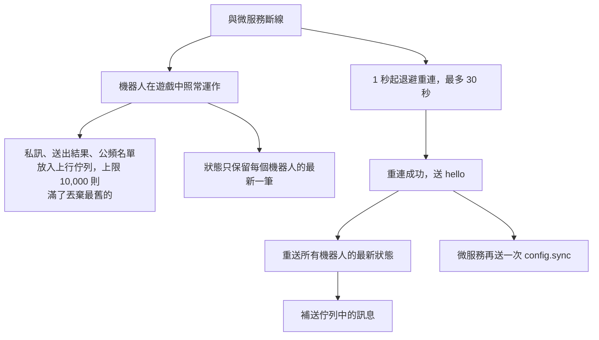

# WD 機器人服務：程式運作流程

本文件依照目前的程式碼整理機器人服務的運作方式。微服務協定的欄位細節見 [backend-protocol.md](backend-protocol.md)，遊戲端 API 見 [WD機器人串接功能與API規格_20261112.md](../WD機器人串接功能與API規格_20261112.md)。

流程圖使用 Mermaid，在 GitHub 或安裝了 Mermaid 擴充的 VS Code 預覽中會顯示成圖。

## 目錄

1. [系統架構](#1-系統架構)
2. [啟動與設定下發](#2-啟動與設定下發)
3. [單一機器人生命週期](#3-單一機器人生命週期)
4. [聊天連線與一廳一機器人](#4-聊天連線與一廳一機器人)
5. [私訊收發](#5-私訊收發)
6. [公頻名單掃描](#6-公頻名單掃描)
7. [token 與 API 錯誤處理](#7-token-與-api-錯誤處理)
8. [與微服務斷線時](#8-與微服務斷線時)
9. [重要參數](#9-重要參數)

## 1. 系統架構

| 元件 | 位置 | 職責 |
|---|---|---|
| WebSocketBackendLink | [WdBot.Backend](../src/WdBot.Backend/WebSocketBackendLink.cs) | 主動連線微服務；接收設定與送訊指令；回報私訊、送出結果、狀態、公頻名單 |
| BotManager | [WdBot.Service](../src/WdBot.Service/BotManager.cs) | 依設定新增、停止、重啟機器人；把 `message.send` 轉給對應的機器人 |
| ChannelRegistry | [WdBot.Service](../src/WdBot.Service/ChannelRegistry.cs) | 記錄每個公頻由哪個機器人佔用，確保一廳一機器人 |
| BotInstance | [WdBot.Service](../src/WdBot.Service/BotInstance.cs) | 單一機器人的完整生命週期，串起下面四個元件 |
| GameSession | [WdBot.Game](../src/WdBot.Game/GameSession.cs) | 帳密登入、刷新 token、API 回 2029 時自動刷新後重送 |
| ChatSupervisor | [WdBot.Game](../src/WdBot.Game/Chat/ChatSupervisor.cs) | 維持聊天 WS 連線：斷線重連、輪替網址、依踢線原因決定是否重連 |
| PrivateMessageSender | [WdBot.Game](../src/WdBot.Game/Chat/PrivateMessageSender.cs) | 依序送出私訊：200 字拆段、間隔 2.1 秒、太快時重試 |
| ChannelMemberScanner | [WdBot.Game](../src/WdBot.Game/Chat/ChannelMemberScanner.cs) | 用 opcode 9 翻完公頻所有分頁 |

## 2. 啟動與設定下發

- 帳號類欄位：env、account、password、device_id、device_model、os、app_version。變更任一項都會重新登入
- 同一個 env 下，同一個帳號只能給一個機器人，否則兩條聊天連線會互相踢線
- 之後微服務可以用 `config.upsert`、`config.remove` 單筆調整，規則相同

## 3. 單一機器人生命週期

- 登入的致命錯誤碼：2001 參數驗證失敗（帳號密碼格式不符）、2002 帳號找不到、2003 登入失敗、2023 密碼錯誤太多次、2024 預約刪除中、2041 帳號密碼不吻合、2045 帳號無法使用、4038 停權
- 進入 `error` 後機器人就停止。後台修正設定後，對同一個 bot_id 再送一次 `config.upsert`，就會重新啟動
- 送私訊時要帶的暱稱、頭像、頭像框、對話框 ID，都從登入與本人資料取得
- 等級 0（沒綁手機）的帳號不會停止：照樣登入、進公頻、收私訊、掃描名單，online 狀態的 detail 會註明無法發言；送私訊時遊戲端會回 5008

## 4. 聊天連線與一廳一機器人

- 公頻由遊戲伺服器隨機分配，無法自選，也沒有離開公頻的指令。撞廳時只能斷線重連，讓伺服器重新分配
- 撞廳重試期間仍可收私訊；`waiting_channel` 期間處於下線狀態，私訊收不到，`message.send` 會回 `-2`
- 佔廳的對照表只存在單一服務程序中，所以只能執行一個機器人服務實例
- 這個機制要成立，前提是重連後伺服器確實可能分到不同的廳。這點需要向遊戲方確認
- 可以在 `appsettings.json` 設 `Bot:OneBotPerChannel = false` 關閉這個機制

## 5. 私訊收發

- 回覆玩家和主動私訊都用 `message.send`；主動私訊只是不帶 `reply_to_message_id`
- 機器人沒有連線時，送出佇列最多等 30 秒，仍未恢復就回 `-2`
- 等待回包逾時（`-3`），或等待時斷線（`-6`），都無法確定訊息是否送達，所以不會自動重送，交給微服務判斷

## 6. 公頻名單掃描

只有 `scan_channel_players` 為 true、而且佔到廳的機器人才會掃描。

- 名單以遊戲方推送為主：連線後伺服器會主動推送 opcode 9（第一頁），機器人不另外送請求；只有超過 100 人（next_cursor 不是空字串）時，才主動要剩下的頁面湊成完整名單。之後靠 opcode 17 維護增減
- 超過 10 分鐘（`Bot:ChannelRescanMinutes`，0 表示關閉）都沒收到 opcode 9 推送，才主動從第一頁掃描一次
- 每次重連都會重新建立名單，因為重連後可能換到別的廳。微服務收到新的 snapshot 時，應該取代該機器人的舊名單
- 機器人自己也以「完整名單＋增減」維護目前在線名單，log 會印出目前在線人數；名單同時寫成實體檔，檔名依大廳編號區分：`logs/roster/{env}/channel-{大廳編號}.json`，可以直接打開查看；離開或換廳時刪除舊大廳的檔案（`Bot:WriteRosterFile`，預設開啟）
- 掃描失敗時不送 snapshot，`bot.status` 維持 online 並在 detail 說明原因，之後照常回報成員異動
- 要私訊誰、是否已經私訊過，都由微服務判斷，機器人不記錄

## 7. token 與 API 錯誤處理

- access_token 有效 1 小時，程式每 50 分鐘主動刷新一次
- 聊天 WS 只在建立連線時驗證 token，所以 token 更新不會讓已建立的聊天連線斷線

## 8. 與微服務斷線時

- 斷線期間微服務送不了 `message.send`，所以機器人無法回覆玩家
- 機器人服務重啟時，佇列中還沒送出的私訊會遺失

## 9. 重要參數

`src/WdBot.Service/appsettings.json` 可以調整的項目：

| 設定 | 預設 | 說明 |
|---|---|---|
| `Backend:Url` | `ws://localhost:5080/ws/bot-service` | 微服務 WebSocket 網址（目前是佔位值） |
| `Backend:ApiKey` | 空 | 連線時帶的 X-Api-Key |
| `Backend:OutboxCapacity` | 10000 | 斷線期間的上行佇列上限 |
| `Bot:TokenRefreshIntervalMinutes` | 50 | 主動刷新 token 的間隔 |
| `Bot:DuplicateLoginCooldownSeconds` | 300 | 被 7000 踢線後等多久重連 |
| `Bot:MaintenanceBackoffSeconds` | 120 | 維護中（7005）等多久重連 |
| `Bot:ChatReconnectMaxSeconds` | 60 | 聊天重連的最長等待 |
| `Bot:SendReplyTimeoutSeconds` | 10 | 送私訊後等回包的時間 |
| `Bot:SendQueueCapacity` | 1000 | 每個機器人的送出佇列上限 |
| `Bot:RestartMaxDelaySeconds` | 300 | 暫時性錯誤後重新登入的最長等待 |
| `Bot:OneBotPerChannel` | true | 是否啟用一廳一機器人 |
| `Bot:ChannelCollisionMaxAttempts` | 10 | 連續撞廳幾次後下線等待 |
| `Bot:ChannelCollisionRetrySeconds` | 5 | 撞廳後隔幾秒重連（另加 0–50% 隨機） |
| `Bot:ChannelWaitingRetrySeconds` | 300 | 下線等待多久再試 |
| `FileLogging:Directory` | logs | 一般 log 的資料夾（每天一個檔案） |
| `FileLogging:MessageDirectory` | logs/messages | 訊息內容 log 的資料夾，依 bot_id 分子資料夾（私訊 messages-*.log、公頻 channel-*.log） |
| `Logging:LogLevel:WdBot.Messages.Private` | Information（本機測試為 Debug） | 設為 Debug 才會寫私訊內容 log；log 輸出位置、格式與保留天數（30 天）見 nlog.config |
| `Logging:LogLevel:WdBot.Messages.Channel` | Information（本機測試為 Debug） | 設為 Debug 才會寫公頻內容 log，可與私訊分開開關 |
| `Bot:ChannelRescanMinutes` | 10 | 超過幾分鐘沒收到遊戲方推送的 opcode 9，才主動掃描一次公頻名單；0 表示不主動掃描 |
| `Game:UnityVersion` | 2022.3.20f1 | 真的 App 使用的 Unity 版本，用在 Header 的 `{unity_version}`；要以抓到的封包為準 |
| `Game:RequestHeaders` | 模擬 Unity 安卓 App | 送給遊戲方的 Header（App API 與聊天 WS），詳見 README |
| `Bot:WriteRosterFile` | true | 是否把在線名單寫到 logs/roster/{env}/channel-{大廳編號}.json |

寫在程式中、依遊戲規格設定的固定值：

| 項目 | 值 | 依據 |
|---|---|---|
| App API 頻率 | 每 60 秒 190 次 | 規格上限 200 次，保留餘量 |
| 私訊間隔 | 2.1 秒 | 規格每 2 秒 1 則 |
| 私訊單則長度 | 200 字 | 規格上限 200 字 |
| 公頻翻頁間隔 | 200 毫秒 | 規格每條連線每秒最多 50 則指令 |
| 聊天單則訊息上限 | 256 KB | 規格上限 |
